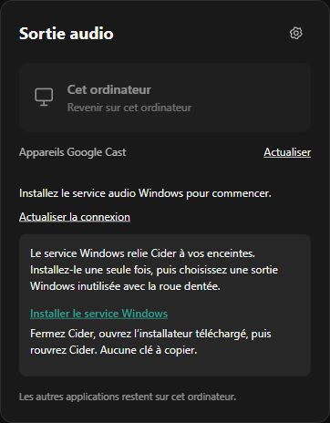

# Validation de la candidate 1.0.0-rc.2

Préparation du 1er novembre 2026. Les sources de ce dépôt ont été reconstruites dans un dossier isolé, sans remplacer la candidate 1.0.0-rc.1 utilisée pour écouter de la musique.

- Compilation Windows et .NET réussie, sans avertissement ni erreur.
- Autocontrôles .NET réussis : chiffrement, RTP, retours réseau, retransmissions, Opus et reprises réseau bornées.
- 89 tests du code réussis, sans test ignoré : interface, connexion locale, restauration, source musicale, transport et six scénarios avec le vrai émetteur en boucle locale.
- 9 tests supplémentaires réussis : installation, mise à jour, retrait, retour arrière et échecs dans de faux profils Windows ; plugin manquant ; gardien détaché ; structure du ZIP ; arguments et extraction réelle de l'EXE.
- Après la dernière retouche d'affichage, les huit contrôles de connexion et du panneau concernés ont été rejoués avec succès. Aucun changement du moteur audio n'est lié à cette retouche.
- Aperçu simulé : message de première installation, lien du service, instructions et accent natif vérifiés. Les données de cet aperçu ne viennent pas d'une session musicale.
- Les fichiers publics ont été contrôlés par liste explicite : aucune configuration privée, aucun journal musical, aucun jeton réel ni chemin du profil de développement dans les sources publiées. Les runtimes sont exclus de Git et inclus dans les téléchargements du service avec leurs licences.

## Restent à qualifier

Importation réelle du ZIP par Cider, installation et désinstallation sur un Windows vierge, longue écoute de cette candidate, transitions/pause/reprise, coupure réseau, retour PC, récupération après fermeture et mise à jour Marketplace réelle. La synchronisation du volume natif dépend de propriétés internes de Cider 4. Les appareils autres que la paire utilisée pour le développement nécessitent leur propre validation.

L'EXE n'a pas de signature éditeur. Ces contrôles ne constituent ni une approbation du Marketplace ni une preuve d'absence de microcoupures audibles.
